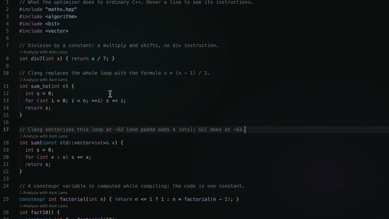

# Asm Lens

See what your code compiles to without leaving the editor. Asm Lens puts the
instruction count of every function above it, opens the function's assembly
next to your code, and links the two: hover a source line to see its
instructions, hover an instruction to see its source line.

It compiles with [Compiler Explorer](https://godbolt.org) (no setup) or with
the compiler installed on your machine (nothing leaves it). C and C++ get the
full treatment, including local headers, header-only code and templates. Rust,
Go, Python, Zig, Swift, D and Fortran are supported too.



## Features

- **Instruction counts as CodeLens** above every function: `12 instructions · GCC 15.2 · -O2`.
  Template functions show every instantiation (`3 instantiations · 4 / 6 / 9 instructions`).
- **Assembly view** next to the editor. Click a count to open it; it follows the cursor
  from function to function.
- **Two-way highlighting**, like Compiler Explorer: each source line and its instructions
  share a color. Hover or click a source line to highlight its instructions; hover an
  instruction to highlight its source line (and the exact token, when the compiler reports a
  column). Everything else stays as it is (`asmLens.dimOtherLines` fades the rest instead).
  Hover a function's signature to preview its whole assembly.
- **Every function, including unused ones**: methods defined inside a class, and `static`, `inline`
  and `constexpr` functions get their own counts even when nothing in the file calls them, with every
  compiler (`asmLens.emitUnusedFunctions`).
- **Headers work**: analyze a `.cpp` and open the headers it includes, and they compile by
  themselves: every function, `static inline` or not, shows code even if the `.cpp` inlined it or never
  called it. A header that needs what the `.cpp` includes or defines before it gets those lines too.
- **Templates show code at once**, with the types the code uses (`Box<int>`), else `int`. Click
  **Instantiate…** above a template to choose others (`int`, `float, 4`, `std::vector<int>`).
- **Robust against real projects**: local headers are found and uploaded the way a
  compiler would find them; a missing header is replaced by an empty file; a function
  that does not compile is skipped and marked *Not compiled*, and the rest is analyzed.
- **Remote or local**, per project or per compiler, on Windows, Linux and macOS. Local mode can take
  each file's compiler and flags from your build's `compile_commands.json`.
- **Any compiler on Compiler Explorer**: GCC, Clang, MSVC (x64, x86, ARM64, ARM32), ICX/ICC, and the
  cross compilers for ARM, RISC-V, MIPS, PowerPC, AVR, MSP430, Z80, 6502 and more. One set of flags
  serves them all: `-O2 -std=c++20` reaches MSVC as `/O2 /std:c++20 /EHsc`.
- **Fast, and visibly working**: a progress notification shows each step (finding headers,
  compiling, retrying around errors) with a **Cancel** button; the status bar and the CodeLens
  spin while it runs. Unchanged code is answered from a cache, and Compiler Explorer is asked
  for compact replies.
- **Live while you edit**: results stay on screen and move with the text; only the functions you
  change show *Updating…*, and the file is analyzed again in the background when you pause typing.

## Quick start

1. [Install the extension](https://marketplace.visualstudio.com/items?itemName=IdanShalom.asm-lens) (or search
   for *Asm Lens* in the Extensions panel) and open a C, C++, Rust, Go, Python, … file.
2. Click **Analyze with Asm Lens** above any function (or run **Asm Lens: Analyze Current File**,
   or right-click in the editor).
3. Click a count to open the assembly view. Hover lines in either view.

While it compiles, a notification shows what is happening and lets you cancel. After that the
counts follow your edits by themselves (see [Editing](#editing)).

## Editing

You do not need to analyze again after a change:

- Results stay visible while you type. Counts below an edit move with the text; a function you change
  shows **Updating…** (or *Changed since the last analysis*), the others keep their numbers.
- When you pause typing (`asmLens.reanalyzeDelayMs`, 1 s) the file is analyzed again in the background,
  with a spinner in the status bar instead of a notification. A newer edit cancels a compile of the older
  text. The open assembly view switches to the new code of the same function.
- Editing a header updates the `.cpp` whose results it shows.
- The whole file is compiled each time, because that is the smallest unit a compiler works on, and a change
  to one function can change every function it is inlined into (or, for a type or a `#define`, everything
  after it). Compiling less would give wrong numbers. What is skipped is everything else: unchanged code
  is answered from a cache, and replies are kept small.

Set `asmLens.reanalyzeOn` to `save` to compile only when you save, or `never` to compile only when you ask.

By default the file is compiled on godbolt.org with GCC 15.2 and `-O2`, in Intel syntax.
Choose another compiler with the compiler name in the status bar (bottom right) or
**Asm Lens: Select Compiler**. To change flags, include folders and so on for a
project, run **Asm Lens: Open or Create Project Config** (see [`.asm-lens.json`](#project-configuration-asm-lensjson)).

## Remote and local mode

|                     | `"mode": "remote"` (default)                                   | `"mode": "local"`                                              |
|---------------------|----------------------------------------------------------------|----------------------------------------------------------------|
| Where it compiles   | A Compiler Explorer server: godbolt.org, or your own (`baseUrl`) | On this machine                                                |
| What leaves the machine | The file, plus the local headers it includes               | Nothing                                                        |
| Compilers           | Any Compiler Explorer compiler: GCC, Clang, MSVC, ICX, … in many versions | The compiler you name: any GCC- or Clang-compatible one for C/C++ (`g++`, `clang++`, `g++-14`, MinGW `g++.exe`, …) |
| Headers             | Found locally and uploaded with their folder layout            | Read from disk by the compiler; `includePaths` become `-I`    |
| Standard library    | The server's                                                   | Yours                                                          |
| Target              | What the server's compiler targets (mostly Linux x86-64)       | Your OS and CPU (x86-64, arm64; ELF, COFF or Mach-O)           |
| Speed               | A network round trip (about 0.5–5 s); unchanged code is answered from a cache | Usually well under a second                                    |
| Works offline       | No                                                             | Yes                                                            |
| Unsaved edits       | Used                                                           | Used                                                           |
| Missing headers, failing functions | Recovered (see below)                           | Recovered the same way                                         |

Choose the mode in `.asm-lens.json` (`"mode": "local"`), per compiler (`{ "id": "...", "mode": "local" }`),
or for every project with the `asmLens.mode` setting. The status bar shows which one is active
(`clang++ (local)` or the Compiler Explorer compiler's name).

Local mode for C/C++ runs `<compiler> <flags> -I<includePaths> -iquote <file folder> -S -g -o - -x c++ -`
with your unsaved text on standard input, then `c++filt` to demangle names. Asm Lens never
runs your program and never builds the rest of the project.

**Assembly syntax.** Asm Lens shows Intel syntax and picks the flag for it itself, because the right
flag depends on the compiler: on Compiler Explorer the server adds it per compiler; locally Asm Lens
asks the compiler what it is (`--version`, `-dumpmachine`) and adds `-masm=intel` (GCC) or
`-mllvm -x86-asm-syntax=intel` (Clang) for x86 targets only. A `-masm=...` in your flags is therefore
not passed on (MSVC and non-x86 compilers reject it); write `-masm=att` to get AT&T syntax instead.
If a compiler rejects any other flag (`cc65: Unknown option: -O2`), that flag is left out, the file is
compiled again, and the output says so.

**Flags for MSVC.** Write your flags once, the GCC/Clang way. For MSVC and clang-cl, Asm Lens translates
the common ones (the output lists each translation) and leaves the rest as written, so flags you write
for MSVC (`/O2 /std:c++latest`) are kept as they are:

| You write | MSVC gets |
|-----------|-----------|
| `-O0`, `-O1`, `-Os`, `-O2`, `-O3` | `/Od`, `/O1`, `/O1`, `/O2`, `/O2` |
| `-Ofast` / `-ffast-math` | `/O2 /fp:fast` / `/fp:fast` |
| `-std=c++14` … `-std=c++20`, `-std=c++23` | `/std:c++14` … `/std:c++20`, `/std:c++latest` |
| `-std=c11`, `-std=c17` | `/std:c11`, `/std:c17` |
| `-Wall`, `-Werror`, `-w` | `/W4`, `/WX`, `/w` |
| `-fno-exceptions`, `-fno-rtti` | `/EHs-c-`, `/GR-` |
| `-mavx`, `-mavx2`, `-mavx512f`, `-fopenmp` | `/arch:AVX`, `/arch:AVX2`, `/arch:AVX512`, `/openmp` |
| `-D…`, `-U…`, `-I…` | the same (cl accepts them) |
| `-g`, `-march=…`, `-mtune=…`, `-m64`, other `-W…` | left out (no equivalent) |

C++ also gets `/EHsc`, as Visual Studio projects do, unless you give an `/EH` option. The other way
round, MSVC flags (`/O2`, `/std:c++20`, `/W4`, `/DNAME`) given to GCC or Clang are translated too.

**Functions nothing calls.** A compiler leaves out a function defined inside a class, or a `static`,
`inline` or `constexpr` one, when nothing in the file uses it (and often when every call was inlined).
To show its code anyway, the copy that is compiled marks such functions `__attribute__((used))` on the
same line (MSVC: a line after the end of the file takes each one's address, or calls a constructor). Your
file is not changed, and if the marked copy does not compile, the file is compiled as written. Set
`asmLens.emitUnusedFunctions` to `false` to see only what the compiler emits on its own.

**Templates without being asked.** A template has no code until it has types, so the copy that is compiled
also instantiates each template, after the end of the file: with the types written where it is used, in the file
or in an analyzed file that includes it (`Box<long>`), otherwise `int` (`1` for a number). The CodeLens names the
types (`3 instructions · Box<long>`). A line that does not compile is dropped, and that template asks for its
types when clicked. Types you chose with **Instantiate…** replace these. `asmLens.autoInstantiateTemplates`
turns this off.

**Headers and the files that include them.** Opening a header after analyzing a file that includes it compiles
the header by itself, once for each saved version (not with `"reanalyzeOn": "never"`). A header with functions that
lack code (compile errors, an `#if` that is off, templates without types) is also compiled the way the files
including it see it: with the preprocessor lines before its `#include`, and with their entries in
`compile_commands.json`, directly or through other headers. A file listed more than once (a 32-bit and a 64-bit build,
in one database or several) is compiled with each entry, a `.cpp` as well. The best result is the main one, and the
others fill in what it lacks, so a function behind `-m32` or `-DFEATURE_A` and one behind `-m64` or `-DFEATURE_B` can
both show code. The CodeLens names the target (`compile_commands.json -m32`).

### compile_commands.json

With `"compileCommands"` in `.asm-lens.json` (or the `asmLens.compileCommands` setting), each file is
compiled the way your build compiles it: with the compiler and flags of its entry in the
`compile_commands.json` database that CMake (`-DCMAKE_EXPORT_COMPILE_COMMANDS=ON`), Bear, Meson and
others write. A header takes the entries of the files that include it, also through other headers. In remote mode
the entry's defines, include folders, language standard and target options (`-m...`) are used, and the
flags in `.asm-lens.json` come after them.

```jsonc
{
  "mode": "local",
  "compileCommands": "build/compile_commands.json",   // or several: ["build/a.json", "build/b.json"]
  "compilers": [{ "id": "local", "extraFlags": "-DASM_LENS" }]
}
```

- The entry's compiler runs in the entry's `directory`, with your editor text on standard input.
  The entry's flags are used without `-c`, `-o <file>`, `-MD/-MMD/-MF/-MT/-MQ`, `-Werror*`, `-x <lang>`
  and the source path; Asm Lens adds `-S -g -o - -w -x c++ -` (or `-x c`) and the syntax flag, and then
  the active compiler's `extraFlags`. Compiler launchers (`ccache`, `sccache`, `distcc`) are skipped.
- A file without its own entry (a header, a new file) uses the entry of a source file that includes it
  (one you analyzed, else one found by searching the nearest folders first), else an entry in the same
  or the nearest folder. Without any database entry, the usual `flags`, `defines` and `includePaths` apply.
- The database is read again whenever it changes; **Asm Lens: Reload Compile Commands** forces it.
  The output shows the final command and which entry was used.
- Local mode needs a GCC- or Clang-compatible compiler; an MSVC (`cl.exe`, `clang-cl`) database is
  reported, and remote mode with an MSVC compiler from Compiler Explorer is the way to see its code.

## Headers and templates

**Analyzing a header on its own.** A header usually compiles to nothing: an `inline` or
`static inline` function that nothing calls is dropped, and a template is just a pattern.
When you analyze a header (`.h`, `.hpp`, `.hxx`, `.hh`, `.inl`, `.ipp`, `.tpp`, …), Asm Lens
marks every non-template function in it `__attribute__((used))` (only in the copy that is
compiled, keeping every line in place), so each one is emitted and gets a count:
free functions, `static inline` functions, and member functions defined inside classes.
If some functions cannot compile on their own (they need another header or a define), only
those say *Not compiled*; the rest keep their counts.

**Templates.** Above every template function, and every member function of a class template,
there is an **Instantiate…** CodeLens. Click it and type the template arguments:

- `square<T>`: type `int` and Asm Lens compiles `square<int>`;
- `mx::Box<T>::twice()`: type `double` and Asm Lens compiles `template struct mx::Box<double>;`,
  which gives the code of every member of `Box<double>`;
- a member template of a class template asks for both argument lists;
- a partial specialization takes its own arguments: for `Stack<T*>`, type `int` to compile `Stack<int*>`.

If a class does not compile as a whole for the types you chose (one member calls `v.size()` and you typed
`int`), only the member you clicked is compiled, and Asm Lens tells you so.

The requests are added after the file's last line, so line numbers do not change. They
are remembered per file (shown in a CodeLens at the top of the file; click it to remove
some) and compiled every time you analyze that file. A request that does not compile
(a misspelled type, for example) is removed and the compiler's message is shown.
Template constructors cannot be instantiated this way; use them from a `.cpp` file instead.

**Analyzing a `.cpp` and then opening its headers.** Every header the `.cpp` includes shows
the result of that analysis (`· via user.cpp`): functions that were emitted show their
counts, and code that was inlined into the `.cpp`'s functions shows as
`N inlined instructions · used in M function(s)`. A function with nothing to show says
*No separate code in user.cpp (inlined or not used)*: click it to analyze the header itself or,
for a template, to choose its types. At `-O2` small template members often end up here even when the
`.cpp` calls them, because their code is merged into the caller.

For each function, the newest analysis that has code for it decides. So analyzing a `.cpp` does
not hide what the header's own analysis found, as long as both used the same compiler, and
templates you instantiated keep showing the code you asked for.

## Languages

| Language       | Remote | Local compiler (default command) | Notes |
|----------------|:------:|-----------------------------------|-------|
| C, C++, Objective-C, Objective-C++ | ✓ | `g++` (any GCC/Clang-compatible compiler) | Headers uploaded, error recovery, header and template support |
| Rust           | ✓ | `rustc` | Compiled as a library with `-C link-dead-code`, so every function is kept; Asm Lens adds that flag |
| Go             | ✓ | `go` | Locally: one file that imports only the standard library |
| Python         | ✓ | `python3` (`python` on Windows) | Shows CPython **bytecode**, one function per code object |
| Zig            | ✓ | `zig` | Only `export` functions (and what they use) are compiled |
| Swift          | ✓ | `swiftc` | |
| D              | ✓ | – | Remote only (LDC) |
| Fortran        | ✓ | `gfortran` | |

For languages other than C and C++, the default remote compiler is Compiler Explorer's default for
that language. Choose another with **Select Compiler**, or list one in `.asm-lens.json` with its
`"language"`. The top-level `flags`, `defines`, `includePaths` and `compiler` are C/C++ settings and
are not used for other languages; give those compilers their own `flags` and `compiler`.

VS Code has built-in support for C, C++, Objective-C, Rust, Go, Python and Swift files. For Zig, D and
Fortran, install an extension that adds the language (for example *Zig Language*, *code-d* or
*Modern Fortran*).

## Project configuration: `.asm-lens.json`

Put a `.asm-lens.json` in the project root (**Asm Lens: Open or Create Project Config** creates one
from a template). It is found by walking up from the analyzed file, also as `.vscode/asm-lens.json`.
It accepts comments and trailing commas, editing it takes effect immediately, and problems in it are
listed in the *Asm Lens* output channel. VS Code validates it as you type.

Settings are taken in this order: the active compiler's own entry, then the top level of
`.asm-lens.json`, then the VS Code settings.

### Example: Compiler Explorer, several compilers

```jsonc
{
  "compilers": [
    { "id": "g152", "name": "GCC 15.2", "flags": "-O2 -masm=intel" },
    { "id": "clang1910", "name": "Clang 19", "flags": "-O3 -march=native" },
    { "id": "cg152", "name": "GCC 15.2 (C)", "language": "c" }
  ],
  "includePaths": ["include", "src/generated", { "path": "third_party", "recursive": true }],
  "defines": ["NDEBUG", "USE_SIMD=1"],
  "buildFolders": ["build", "out"]
}
```

### Example: local compiler

```jsonc
{
  "mode": "local",
  "compiler": "g++-14",              // or "clang++", "C:/msys64/ucrt64/bin/g++.exe", "./tools/bin/g++"
  "flags": "-O2 -std=c++20 -march=x86-64-v3",
  "includePaths": ["include"]
}
```

### Example: mixing languages and modes

```jsonc
{
  "mode": "local",
  "compilers": [
    { "id": "local-gcc", "name": "GCC", "compiler": "g++", "flags": "-O2" },
    { "id": "r1990", "name": "Rust 1.99", "language": "rust", "mode": "remote", "flags": "-C opt-level=3" },
    { "id": "py", "name": "Python 3.12", "language": "python", "compiler": "python3.12" }
  ]
}
```

### All options

| Key | Type | Default | Meaning |
|-----|------|---------|---------|
| `mode` | `"remote"` \| `"local"` | `asmLens.mode` (`"remote"`) | Where to compile (see [Remote and local mode](#remote-and-local-mode)). |
| `compiler` | string | `asmLens.localCompiler`, else `g++` | Local mode, C/C++: the compiler command or path. A path starting with `./` or `../` is relative to the config file. |
| `compileCommands` | string \| string[] | `asmLens.compileCommands` | Local mode: `compile_commands.json` file(s), relative to this file. See [compile_commands.json](#compile_commandsjson-local-mode). |
| `compilers` | array | `asmLens.compilerId` | Compilers in order of preference. The first one for a language is the default; switch with the status bar. An entry is a Compiler Explorer id (`"g152"`) or an object (below). |
| `flags` | string | `asmLens.flags` (`-O2 -masm=intel`) | C/C++ flags for compilers without their own `flags`. A `-masm=...` flag only chooses the syntax (see above). |
| `language` | `"c"` \| `"c++"` | by file type | Force the language of C-family files (for example compile `.c` files as C++). |
| `includePaths` | array | `[]` | Folders searched for `#include`s, in priority order. A string, or `{ "path": "...", "recursive": true }` to also search every subfolder. Relative to the config file. |
| `buildFolders` | string[] | `build`, `out`, `bin`, `cmake-build-*`, `generated`, … | Folder names searched last, for generated headers. Wildcards allowed. |
| `excludePaths` | string[] | `[]` | Glob patterns of folders whose headers are never uploaded, added to the built-in list (`**/libcxx/**`, `**/*llvm-project*/**`, `**/sysroot/**`, `**/node_modules/**`, …). A bare name such as `"vendor"` means any folder with that name. |
| `defines` | string[] | `[]` | Preprocessor defines, passed as `-D<name>` (`"NDEBUG"`, `"LEVEL=2"`; a leading `-D` is accepted). |
| `extraFlags` | string \| string[] | `""` | C/C++ flags added after all others. |
| `uploadSystemHeaders` | boolean | `false` | Remote: also upload workspace copies of standard headers (`vector`, `stdio.h`, …). Normally the server's own are used. |
| `baseUrl` | string | `asmLens.baseUrl` (`https://godbolt.org`) | Compiler Explorer server, for example a self-hosted one that keeps code in-house. |
| `maxIncludeFiles` | number | `asmLens.maxIncludeFiles` (80) | Remote: most local headers uploaded per analysis. |

Each object in `compilers` may have:

| Key | Type | Meaning |
|-----|------|---------|
| `id` | string (required) | Compiler Explorer compiler id, such as `g152`, `clang1910`, `r1990`. Use **Select Compiler → Browse** to look them up (they differ per server). In local mode it is only a name. |
| `name` | string | Label for the status bar and CodeLens. |
| `flags` | string | Flags for this compiler; replaces the top-level `flags`. |
| `language` | `c`, `c++`, `rust`, `go`, `python`, `zig`, `swift`, `d`, `fortran` | Use this compiler only for that language. Without it the compiler is for C and C++. |
| `mode` | `"remote"` \| `"local"` | Overrides the top-level `mode` for this compiler. |
| `compiler` | string | Local mode: the command or path (`clang++-18`, `rustc`, `python3.12`). |
| `defines` | string[] | Extra `-D` defines for this compiler (C/C++). |
| `extraFlags` | string \| string[] | Flags added after the others. |

## VS Code settings

| Setting | Default | Meaning |
|---------|---------|---------|
| `asmLens.mode` | `remote` | Where to compile when `.asm-lens.json` does not say. |
| `asmLens.localCompiler` | `""` (= `g++`) | Local C/C++ compiler when `.asm-lens.json` does not name one. |
| `asmLens.compileCommands` | `""` | Local mode: `compile_commands.json` file(s), relative to the workspace folder, when `.asm-lens.json` has no `compileCommands`. |
| `asmLens.reanalyzeOn` | `edit` | When an analyzed file (or a header it uses) changes: `edit` analyzes again in the background once typing pauses (and on save), `save` only on save, `never` only when you ask. |
| `asmLens.reanalyzeDelayMs` | `1000` | With `edit`: how long typing must pause first. |
| `asmLens.baseUrl` | `https://godbolt.org` | Compiler Explorer server. |
| `asmLens.compilerId` | `g152` | Compiler Explorer compiler for C/C++ without a project file. **Select Compiler** sets it. |
| `asmLens.compilerName` | `""` | Its label in the status bar and CodeLens (empty: the id). Select Compiler fills it in. |
| `asmLens.flags` | `-O2 -masm=intel` | C/C++ flags. |
| `asmLens.language` | `c++` | Language sent for C-family files without a project file. |
| `asmLens.includePaths` | `[]` | Extra include folders, searched after the project file's. |
| `asmLens.maxIncludeFiles` | `80` | Most local headers uploaded per analysis. |
| `asmLens.autoInstantiateTemplates` | `true` | C++: compile templates without being asked, with the types the code uses, else `int` (see above). |
| `asmLens.emitUnusedFunctions` | `true` | C/C++: also show functions defined in a class, `static`, `inline` and `constexpr` ones that nothing in the file calls (see above). Headers analyzed on their own always do this. |
| `asmLens.skipFailingFunctions` | `true` | Skip functions that do not compile instead of failing. |
| `asmLens.maxRecoveryAttempts` | `12` | Most compiles per analysis while recovering. |
| `asmLens.stubFailingHeaders` | `false` | Remote: replace an uploaded header that fails in the preprocessor (`#error`) by an empty file. |
| `asmLens.confirmRemoteUpload` | `true` | Ask before sending code to a Compiler Explorer server for the first time (see [Privacy](#privacy)). Off: never ask, for any server. |
| `asmLens.requestTimeoutMs` | `60000` | How long to wait for one compile, in ms. A Compiler Explorer server that does not answer in time is asked once more. |
| `asmLens.showCounts` | `true` | Show the CodeLens. |
| `asmLens.highlightOnHover` | `true` | Two-way highlighting. |
| `asmLens.colorizeLines` | `true` | Color source lines and their instructions alike. |
| `asmLens.dimOtherLines` | `false` | While an instruction is hovered, also fade the other lines of its function (editor) and the other instructions (assembly view). Off: only the matching lines are highlighted. |
| `asmLens.followCursor` | `true` | The assembly view follows the function under the cursor. |

## Commands

| Command | What it does |
|---------|--------------|
| Asm Lens: Analyze Current File | Compile the file and show counts (also in the editor's context menu). |
| Asm Lens: Select Compiler | Choose a compiler from `.asm-lens.json`, or browse Compiler Explorer's list for the file's language. |
| Asm Lens: Instantiate Template at Cursor… | Same as the **Instantiate…** CodeLens. |
| Asm Lens: Remove Template Instantiations… | Remove instantiation requests of the current file. |
| Asm Lens: Open or Create Project Config (.asm-lens.json) | Open the project file, creating it from a template. |
| Asm Lens: Reload Compile Commands | Read the `compile_commands.json` database(s) again and analyze the file again. |
| Asm Lens: Show Output | The log: what was compiled, uploaded, skipped and why. |

## When code does not compile

Projects rarely compile from a single file without their build system. Asm Lens recovers instead of giving up:

1. **A flag the compiler does not accept**: left out (the output says which).
1. **Missing header**: retried with that header replaced by an empty file.
2. **A function that then fails** (it used something from that header): the function is blanked out
   (line numbers stay the same) and the rest is compiled again. Its CodeLens says *Not compiled*.
3. Each retry is one more compile, up to `asmLens.maxRecoveryAttempts`.

Only the copy that is compiled changes, never your files. Everything that was skipped is listed in the
*Asm Lens* output. If a header is not on any include path, the workspace is searched for it
(case-insensitively): first your normal folders, then build output folders, where generated headers
live. If that is not enough, add the folders to `includePaths`, the needed `defines`, or switch to local
mode, where your own compiler and system headers are used.

## Troubleshooting

- **"Instantiations not compiled yet"**: instantiations are saved per file but compiled only when that
  file itself is analyzed. Click the CodeLens.
- **"No separate code in user.cpp (inlined or not used)"**: that `.cpp` has no code to attribute to this
  function, and the header has not been compiled by itself (`"reanalyzeOn": "never"`). Click the CodeLens.
- **"Box<int> does not compile: ..."**: the types tried, with the compiler's message. Click the CodeLens to choose others.
  A type you choose can come from the standard library (`std::vector<int>`, its header is added) or from any header the
  `.cpp` including this file includes.
- **"Template: click to choose its types"**: it has not been compiled with any types yet.
- **"Not compiled · inside #ifdef X, which is off in all 3 compile commands tried"**: none of them turns it on. Every
  entry of `compile_commands.json` for the file or for a file including it is tried, so a 32-bit and a 64-bit entry
  both count. Add the define to `"defines"` in `.asm-lens.json` if you want it on anyway.
- **"Not compiled · ..."** with a compiler's message: it does not compile here, even with what comes before the
  `#include`. The other functions are not affected.
- **"for -mavx2 (not in your flags)"**: a SIMD helper needs that feature, so it was compiled for it, to show its code.
- **"No code found · click for details"**: everything was tried, and the compiler produced nothing for it. The
  Asm Lens output says what happened; please report it, with the function, if it does not make sense.
- **Local mode on macOS: errors in C++11 code** (`'auto' type specifier is a C++11 extension`): Apple
  clang 14 and older compile C++98 by default. Asm Lens then adds `-std=gnu++17` (the default of current
  compilers and of Compiler Explorer) and says so in the output; put a `-std=...` in your flags to choose.
- **Rust shows nothing**: only `pub` functions (and what they use) are compiled into a library.
- **Zig shows nothing**: mark functions `export`.
- **Local mode: "g++ was not found"**: install a compiler or set `"compiler"` (or `asmLens.localCompiler`)
  to its full path. On Windows, MinGW-w64 (MSYS2) and LLVM both work; MSVC's `cl.exe` does not.
- **Hover highlighting does nothing**: the compiler gave no line information for that function. All
  defaults include it; flags such as `-g0` remove it.
- **A compiler id does not work**: ids differ between Compiler Explorer servers and change over time;
  use **Select Compiler → Browse**.
- **"godbolt.org did not answer within 60 s, twice"**: the public Compiler Explorer is shared, and at busy
  times a compile can wait in its queue (the progress shows the seconds meanwhile). Asm Lens asks once
  more by itself; if it still gets no answer, analyze again in a moment, raise `asmLens.requestTimeoutMs`,
  or use local mode.
- **"godbolt.org is limiting how often it compiles (HTTP 429)"**: the public server allows a limited number
  of compiles per minute. Automatic re-analysis pauses for 30 seconds; set `asmLens.reanalyzeOn` to `save`
  if you hit this often, or use local mode or your own Compiler Explorer (`baseUrl`).
- **Some compilers need their own flags**: for example GCC for 6502 wants `--target=...`, and z88dk a
  `+target` first argument. Give such a compiler its `flags` in `.asm-lens.json`.
- See **Asm Lens: Show Output** for the exact command, flags and compiler messages.

## Privacy

In **remote** mode the analyzed file and the local headers it includes are sent to the Compiler Explorer
server in `baseUrl` (godbolt.org by default; see its [privacy policy](https://godbolt.org/#privacy)).
Asm Lens asks before sending anything to a server for the first time, and analyses that start by themselves
never send before you agree. **Send** holds until VS Code restarts. **Send, Don't Show Again** holds for that
server only, so a project whose `.asm-lens.json` names another server asks again.
Requests name the extension and its version in their `User-Agent`, and nothing about you or your machine.
Use **local** mode, or a self-hosted Compiler Explorer, for code that must stay private. In local mode
nothing is sent anywhere.

## Development

```sh
npm test                 # unit tests, recorded Compiler Explorer responses, and every local compiler found
npm run test:remote      # the same against the live godbolt.org
node test/run.js --record   # refresh the recorded responses (test/fixtures/ce)
node test/tools/survey-ce.js c++   # one compiler of every Compiler Explorer family (c or c++; network)
node test/tools/stress-headers.js  # the C/C++ scanner on large real-world headers (network, clang)
npm run package          # build asm-lens-<version>.vsix (needs network for npx)
```

There are no runtime dependencies and no build step: the extension is plain JavaScript in `src/`:

| File | Contents |
|------|----------|
| `src/extension.js` | VS Code integration: commands, CodeLens, hover, the assembly view, remote and local compiles |
| `src/cppScan.js` | C/C++ source scanning: functions, classes, templates; keeping header functions; instantiation requests |
| `src/asm.js` | Assembly parsing (ELF, COFF, Mach-O), symbol names, source mapping, compiler diagnostics |
| `src/languages.js` | Rust, Go, Python, Zig, Swift, D, Fortran |
| `src/projectConfig.js` | `.asm-lens.json` parsing and validation |

Every push builds the `.vsix` on GitHub Actions (tests on Windows, Linux and macOS first); it is attached to
the workflow run.

To release, set the new version in `package.json` and push a matching tag such as `v0.8.6`. That creates a
GitHub release with the `.vsix` and publishes it to the Visual Studio Marketplace with
[Trusted Publishing](https://code.visualstudio.com/api/working-with-extensions/publishing-extension), so no
token is stored. It needs a policy for this repository and `build-vsix.yml` on the publisher's Trusted
Publishing page. Open VSX is published too when the `OVSX_PAT` secret is set.

## License

[MIT](LICENSE)
