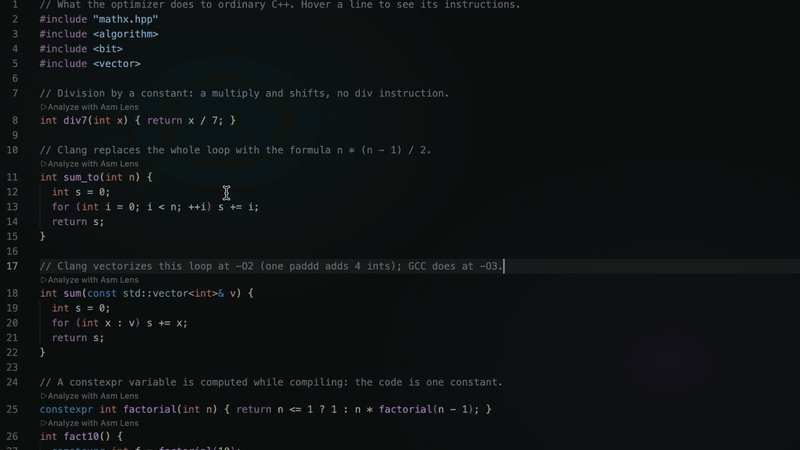

# Recording the demo

A small project to record the Marketplace GIF with. Open this folder in VS Code (File → Open Folder →
`demo`) with Asm Lens installed. Not part of the extension package.

## Before recording

- Use a clean VS Code profile (Profiles → Create Profile) so other extensions and their CodeLens and
  icons are not in the picture.
- A common dark theme (Dark Modern), zoom in twice (Ctrl/Cmd + =), close the minimap, the Explorer and
  the bottom panel. A window of about 1280×720.
- Optional: **Developer: Toggle Screencast Mode** shows the keys you press.
- Run **Asm Lens: Analyze Current File** on `shapes.cpp` once before recording, so the compilers are
  warm, then close the assembly view.

## Shot list (about 45 seconds)

1. `shapes.cpp`: right-click → **Analyze Current File**. The progress notification appears, then the
   counts above every function, including `Circle::area` and `Circle::scaled` inside the class.
2. Click the count above `sum`: the assembly view opens beside the editor.
3. Hover the `for` line in `sum`: its instructions light up. Then hover instructions in the assembly
   view: the source line (and token) lights up in the editor.
4. Move the cursor into `main`: the view follows to `main`.
5. Edit: change `s += x` to `s += x * x`. Only `sum` shows *Updating…*, then the new count.
6. Status bar → **Select Compiler** → MSVC: the counts and the assembly change (the flags become
   `/O2 /std:c++20 /EHsc`).
7. Open `vec.hpp`: click **Instantiate…** above `dot`, type `float`, and see the code for `dot<float>`.

## Recording and converting

- macOS: Cmd+Shift+5 → Record Selected Portion. Windows: Win+Alt+R (Xbox Game Bar) or
  [ScreenToGif](https://www.screentogif.com/). Linux: [Peek](https://github.com/phw/peek) or OBS.
  [OBS Studio](https://obsproject.com/) works everywhere.
- To GIF (the Marketplace shows images, not videos), keep it under ~10 MB, about 900 px wide, 12–15 fps:

  ```sh
  ffmpeg -i demo.mov -vf "fps=12,scale=960:-1:flags=lanczos,split[a][b];[a]palettegen=max_colors=128[p];[b][p]paletteuse=dither=bayer" -loop 0 demo.gif
  ```

  [gifski](https://gif.ski/) gives smaller, sharper GIFs: `gifski --fps 12 --width 960 -o demo.gif demo.mov`.
- Save it as `images/demo.gif` and add it near the top of the main README:

  ```md
  
  ```

  An absolute `https` link works on GitHub, the Marketplace and Open VSX (the repository must be public).
- Upload the full-quality video (MP4) to YouTube or a GitHub release and link it from the README too.
